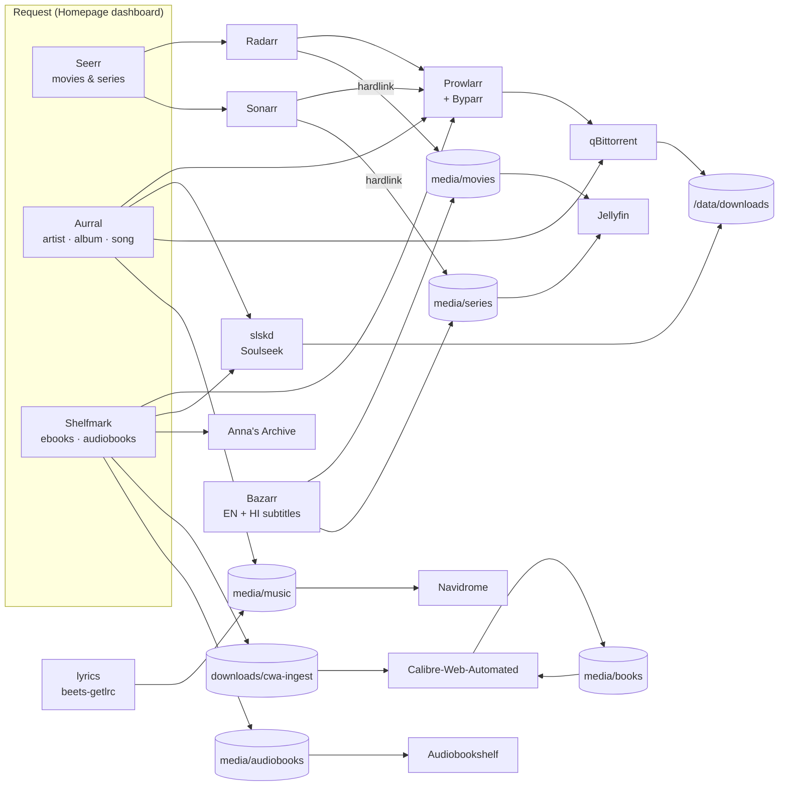

# homelab-media

A self-hosted media system built only from maintained open-source projects:
request something from **one dashboard**, it downloads from the right place,
lands **sorted** into `movies / series / music / books / audiobooks`, gets
**subtitles** (video) or **synced lyrics** (music), and shows up in the right player.



## What does what

| Need | App | Port |
|---|---|---|
| Dashboard (start here) | Homepage | 3005 |
| Request movies & series | Seerr | 5055 |
| Request music: a whole artist, an album or one song | Aurral | 3001 |
| Request ebooks & audiobooks | Shelfmark | 8184 |
| Watch | Jellyfin (Intel Quick Sync transcoding) | 8096 |
| Listen | Navidrome (any Subsonic app works) | 4533 |
| Read: web reader, OPDS, Kobo sync, KOReader sync, send-to-Kindle | Calibre-Web-Automated | 8183 |
| Audiobooks & podcasts | Audiobookshelf (official iOS/Android apps) | 13378 |
| Movie / series automation | Radarr / Sonarr | 7878 / 8989 |
| Subtitles (English + Hindi, only when missing) | Bazarr | 6767 |
| Synced lyrics (`.lrc` next to each track, ~2 min after it lands) | `lyrics` (beets + beets-getlrc) | – |
| Indexers | Prowlarr + Byparr (Cloudflare solver) | 9696 |
| Torrents / Soulseek | qBittorrent / slskd | 8080 / 5030 |
| Clean up stuck downloads | Cleanuparr | 11011 |
| Listening history | Maloja | 42010 |

## Folders

Everything lives under one host folder, `${DATA}`, mounted as **`/data` in every
container**, so moving a finished download into the library is an instant
rename or hardlink (no copies, no double disk usage).

```
/data
├── downloads
│   ├── torrents/{movies,series,music,books,audiobooks,incomplete}   qBittorrent categories
│   ├── soulseek/{complete,incomplete}                                slskd
│   └── cwa-ingest                                                    Calibre-Web-Automated imports (and then empties) this
└── media
    ├── movies       Radarr      → Jellyfin
    ├── series       Sonarr      → Jellyfin
    ├── music        Aurral      → Navidrome   (+ .lrc lyrics)
    ├── books        Calibre-Web-Automated library (metadata.db)
    ├── audiobooks   Shelfmark   → Audiobookshelf
    └── podcasts     Audiobookshelf
```

Subtitles are saved next to each video as `Name.en.srt` / `Name.hi.srt`;
lyrics next to each track as `Track.lrc`.

## Deploy

```bash
cp .env.example .env    # fill in paths, domain, API keys
docker compose up -d --build
```

The first-run checklist is in [docs/first-run.md](docs/first-run.md).

## Decisions

- **Pinned versions.** Every image is pinned, so this repo is an exact record of
  what runs; updates are deliberate commits.
- **No Lidarr.** Aurral handles artists, albums *and* single songs itself
  (Soulseek → torrents → yt-dlp fallback) and writes a clean `Artist/Album/NN - Title` library.
- **Aurral is patched for a slow host** ([`aurral/Dockerfile`](aurral/Dockerfile),
  which refuses to build if the upstream code changes):
  - It gives a YouTube Music search 15 s (hard-coded); here one yt-dlp call took
    4–10 s, so songs that only YouTube has always failed. Raised to 60 s.
  - Its YouTube lookups run on the second machine ([`remote/ytdlp/`](remote/ytdlp/)).
    One search starts up to seven yt-dlp processes: ~200 MB and 15 CPU-seconds
    here, which pushed other apps into swap. Now it costs this host ~20 MB and
    ~1 CPU-second and takes ~7 s instead of ~20 s. Downloads still run here, and
    if the second machine is off Aurral does the lookups itself.
- **No Recyclarr / TRaSH profiles.** They score public-tracker groups (YTS/YIFY…)
  at −10000, which would block most releases on the public indexers used here.
  Radarr/Sonarr's built-in *HD-1080p* profiles are used instead.
- **Small files first.** Radarr's preferred size is ~2 GB per film instead of the
  default ~10 GB, and releases tagged as Spanish dubs are rejected
  ([first-run](docs/first-run.md#4-movies--series)). To pick a specific copy, use
  the movie's *Interactive Search* in Radarr.
- **Jellyfin stays on 10.11.x for now.** Jellyfin 12 is out; that upgrade is a
  separate, deliberate step (database migration, client compatibility).
- **Jellyfin and Navidrome mount media read-only**, so a player can never delete files.
- **Recycle bins** are enabled in Radarr/Sonarr (`/data/media/.recycle`), so an
  upgrade or delete is recoverable for 14 days.
- **Shelfmark lite image.** The standard image bundles Chromium (~2 GB RAM).

## Lean mode (8 GB host)

Everything runs at its core job; optional extras that quietly eat RAM, CPU or disk are off.

| App | Off / reduced | Re-enable |
|---|---|---|
| all .NET apps (Radarr, Sonarr, Prowlarr, Jellyfin, slskd, Cleanuparr) | server GC → `DOTNET_gcServer=0`, `DOTNET_GCConserveMemory=7` | remove the env vars |
| Byparr, Cleanuparr | not started by default (compose profiles `cloudflare`, `extras`); Byparr runs on a second machine instead (`remote/byparr/`) | `docker compose --profile cloudflare --profile extras up -d` |
| Aurral's YouTube lookups | run on a second machine (`remote/ytdlp/`); downloads stay here | empty `YTDLP_REMOTE_URL` |
| Jellyfin | trickplay thumbnails, chapter images, loudness/segment scans, periodic metadata refresh; scan concurrency 2 | library settings + Scheduled Tasks |
| Radarr / Sonarr | folder rescan only after manual refresh; RSS sync 60 min | Media Management / Indexers |
| Navidrome | artwork pre-cache, insights telemetry; full scan daily (watcher catches changes) | env vars |
| Aurral | news, shows and discovery feeds (new releases kept); worker heap 384 MB, idle workers unloaded after 1 min | Settings → Inbox; env vars |
| Calibre-Web-Automated | duplicate backup copies, zip backups, update polling, mobile blur | CWA Settings |
| qBittorrent | 200 connections (60/torrent), 3 active downloads, LSD/RSS/embedded tracker off | Options |
| slskd | search history kept 1 day, transfer records 1 day, stale partials 7 days | `retention:` in slskd.yml |
| Bazarr | analytics | Settings → General |
| lyrics | cheap check every 2 min, works only when new tracks land; full pass daily (remembered across restarts, so a reboot doesn't trigger an extra one) | `CHECK_SECONDS`, `FULL_SECONDS` |
